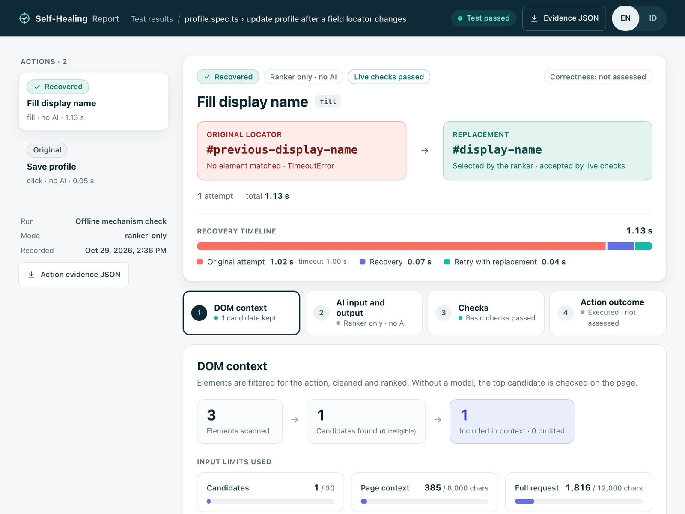
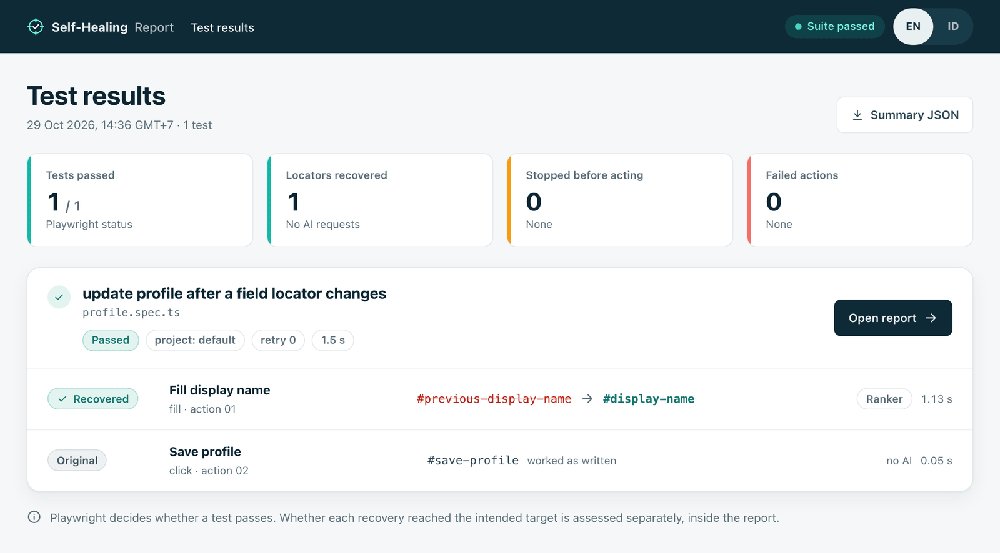
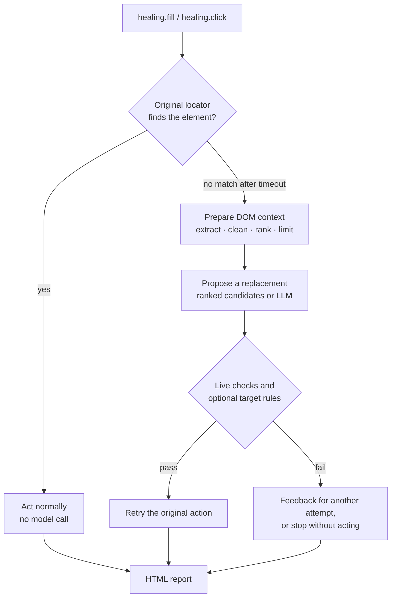
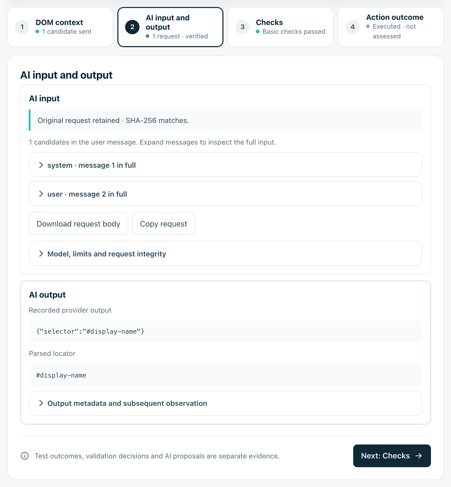

<p align="center">
  
</p>

<h1 align="center">Self-Healing Tool</h1>

<p align="center">
  <strong>LLM-assisted locator recovery for Playwright, with every decision on record.</strong>
</p>

<p align="center">
  When a page change breaks a test's locator, the tool prepares the page context, finds a replacement,<br />
  checks it on the live page before acting, and records the whole recovery in a local HTML report.
</p>

<p align="center">
  
  
  
  
  
</p>

<p align="center">
  <a href="#quick-start"><strong>Quick start</strong></a> ·
  <a href="#how-it-works">How it works</a> ·
  <a href="#inspect-every-recovery">The report</a> ·
  <a href="#turn-on-llm-assisted-recovery">LLM mode</a> ·
  <a href="#research">Research</a> ·
  <a href="docs/index.md">Documentation</a>
</p>

> [!NOTE]
> **Research prototype, accepted for presentation at APSEC 2026 (Tool Demonstration track).** Keep your own assertions: an action that completes after recovery is not, by itself, proof that it reached the intended element.

<p align="center">
  
</p>
<p align="center"><sub>Action report produced by the <a href="#quick-start">quick start</a> below, in ranker-only mode with no API key. Captured on 29 October 2026.</sub></p>

## Why it exists

UI tests find elements through locators. A redesign can rename an `id` or move a field, and the test fails even though a user can still do exactly the same thing. A language model can suggest a replacement, but what it suggests depends on the page context it receives, and a plausible replacement can still be the wrong element.

Self-Healing Tool wraps the Playwright actions you choose and makes each part of that recovery explicit:

| Prepare the context | Check before acting | Keep the evidence |
| --- | --- | --- |
| Candidates are filtered for the action, cleaned, ranked and fitted within explicit size limits before any model call. | A replacement must match one visible, enabled element that fits the action. Optional target rules can stop recovery instead of acting on the wrong element. | DOM context, model input and output, check decisions and outcomes are written to a local HTML report for every action. |

## Quick start

Run a self-contained test that recovers a broken locator. It uses **ranker-only** recovery, so it needs no API key, no external application and no paid request.

You need **Node.js 22–25**, **npm** and **Git**.

### 1. Create a project and install

```sh
mkdir healing-example && cd healing-example
npm init -y && npm pkg set type=module
npm install --save-dev @playwright/test github:wildanniam/self-healing-tool
npx playwright install chromium
mkdir tests
```

npm builds the library from source during installation, so the first install can take up to half a minute. `@playwright/test` brings Playwright with it. The package is not published to the npm registry yet. Using pnpm? It needs [one extra setting](docs/playwright.md#troubleshooting).

### 2. Add the reporter to `playwright.config.ts`

```ts
import { defineConfig } from '@playwright/test';
import type { HealingFixtures } from 'self-healing-tool/playwright';

export default defineConfig<HealingFixtures>({
  testDir: './tests',
  workers: 1,
  retries: 0,
  reporter: [
    ['list'],
    ['self-healing-tool/reporter', {
      outputDir: 'output/healing',
      open: 'always',
      language: 'en',
    }],
  ],
  use: {
    healingOptions: {
      config: { mode: 'ranker-only' },
      audit: true,
    },
  },
});
```

Configure this once. The fixture records every wrapped action, and the reporter builds one HTML index per run. `audit: true` keeps the model's input and output whenever a model is used.

### 3. Write a test with an outdated locator in `tests/profile.spec.ts`

```ts
import { test, expect } from 'self-healing-tool/playwright';

test('update profile after a field locator changes', async ({ page, healing }) => {
  await page.setContent(`
    <label>Display name <input id="display-name"></label>
    <button id="save-profile" onclick="
      document.querySelector('[role=status]').textContent =
        'Saved: ' + document.querySelector('#display-name').value;
    ">Save profile</button>
    <p role="status"></p>
  `);

  await healing.fill('#previous-display-name', 'Taylor', {
    description: 'Fill display name',
  });
  await healing.click('#save-profile', { description: 'Save profile' });
  await expect(page.getByRole('status')).toHaveText('Saved: Taylor');
});
```

The page has `#display-name`, but the test still uses the old `#previous-display-name`. The Save button keeps its original locator, and the final assertion is ordinary Playwright.

### 4. Run it

```sh
npx playwright test
```

```text
Running 1 test using 1 worker

  ✓  1 tests/profile.spec.ts:3:1 › update profile after a field locator changes (1.2s)

  1 passed (1.6s)

Self-healing report: /…/healing-example/output/healing/run-…/index.html
```

The fill times out on the old locator, the library selects and checks `#display-name`, and the test passes. The report opens in your browser. When the `CI` environment variable is set, it is only written to disk.

### 5. Open the report

<p align="center">
  
</p>

Choose **Open report**. It opens on the recovered fill; the Save action, which worked without recovery, is next in the action list. Next steps: [use your own application](docs/playwright.md#use-your-own-application), [turn on LLM-assisted recovery](#turn-on-llm-assisted-recovery), or read the [Playwright guide](docs/playwright.md).

## How it works



1. **Try the original locator.** If it works, the action runs normally and no model is called.
2. **Prepare the DOM context.** After a zero-match timeout, the tool extracts visible, enabled candidates that fit the action, cleans them, keeps labels and row or container context, ranks them, and fits them within candidate and character limits.
3. **Propose a replacement.** Ranker-only mode uses the candidates in ranked order. Full mode asks an LLM for one selector, or none.
4. **Check before acting.** The selector must match one visible, enabled element that fits the action, and enforced target rules must agree. A failed check gives feedback for another attempt (at most three) or stops recovery.
5. **Record the evidence.** The report keeps the context, request, response, check decisions and outcome of every action.

Navigation, setup and assertions stay in your tests. The library does not rewrite test files.

## Inspect every recovery

Every test gets an action report that starts with the result: the original and replacement locator, whether AI was used, whether the live checks passed, and a recovery timeline. Four stages, in English or Bahasa Indonesia, hold the evidence:

| Stage | What you can inspect |
| --- | --- |
| DOM context | Retained candidates, context fields, and recorded ranking scores |
| AI input and output | The captured request and returned text for the selected attempt |
| Checks | Locator validation and optional target-rule decisions |
| Outcome | Execution status and independent effect assessments when supplied |

<p align="center">
  
</p>
<p align="center"><sub>Full mode with <code>gpt-4o-mini</code> on the same synthetic page: the recorded request, the raw response and the parsed locator. Recorded on 22 September 2026 for the APSEC demonstration and shown in the current report layout.</sub></p>

The action status and the test status stay separate, and correctness is shown on its own. *Correctness: not assessed* means the action completed but no independent check of its effect was supplied. Detailed reports can contain application context, so review them before sharing. See [audit setup and capture limits](docs/integration.md#local-action-audit-reports).

## Turn on LLM-assisted recovery

After the offline quick start works, add a provider to `playwright.config.ts`:

```ts
import { validateConfig, createOpenAIProvider } from 'self-healing-tool';

const config = validateConfig({ mode: 'full' });
const key = process.env.OPENAI_API_KEY;
if (!key) throw new Error('OPENAI_API_KEY is required for full mode');
const provider = createOpenAIProvider({ apiKey: key, config, maxRequests: 3 });

// inside `use`:
// healingOptions: { config, provider, audit: true },
```

Set `OPENAI_API_KEY` in your terminal before running. Eligible recoveries then make real, billable requests; `maxRequests` caps each provider instance, and actions whose original locator works never call the model. The [Playwright guide](docs/playwright.md#optional-enable-llm-assisted-recovery) covers budgets and custom providers.

## Use it in your own tests

- Import `test` and `expect` from `self-healing-tool/playwright`.
- Replace `page.setContent(...)` with `page.goto(yourAppUrl)`.
- Wrap only the actions you want protected: `healing.click(selector, task)` and `healing.fill(selector, value, task)`. The `description` states the intent and is used during recovery.
- Keep navigation and assertions as ordinary Playwright code.
- For other test runners or manual lifecycle control, use the [core API guide](docs/integration.md).
- **Optional target rules** describe what the right element must be. Supply them as a structured target contract to guide the model and enforce them before acting; see [optional target contracts](docs/integration.md#optional-target-contracts).

## Research

This repository accompanies **LLM-Assisted Locator Recovery for Playwright: DOM Context Preparation and Target Checks**, accepted for presentation in the APSEC 2026 Tool Demonstration track.

- **Demo video:** [APSEC 2026 tool demonstration](https://youtu.be/vz3v4WI9_CI) shows library usage, LLM-assisted recovery on a synthetic profile page, the report, and a separate recorded target-rule example.
- **Evaluated version:** [v0.1.0](https://github.com/wildanniam/self-healing-tool/tree/v0.1.0). To install exactly that version, see [reproduce the paper version](docs/playwright.md#reproduce-the-paper-version-v010).
- **Evidence:** methods, retained results and their limits are listed under [research and reproducibility](docs/index.md#research-and-reproducibility).

| Study | Runs | What it found |
| --- | --- | --- |
| Candidate ranking (RQ1) | 108 | Full ranking and a Jaccard baseline both kept the target and acted correctly in 36 of 36 runs; disabling the additional context score gave 30 of 36. Full ranking showed no advantage over Jaccard. |
| Target rules (RQ2) | 378 | With no valid target on the page, runs without rules acted wrongly 15 times in 24, while pre-execution checks stopped all 24 runs. Misleading labels still caused wrong actions in every configuration, and missing or outdated rules can block a feasible recovery. |

These are controlled studies of known conditions within one model family. A stop avoids a wrong effect but does not complete the original task.

## Scope and limitations

- Explicit string-selector `click` and `fill` wrappers, ESM only. Chromium is the tested browser.
- Node.js 22–25 and Playwright `>=1.62.1 <2`. CI runs the packaged library with Playwright 1.62.1 and the newest 1.x release; other versions in the range are accepted but not individually verified.
- Recovery handles supported zero-match timeouts. Other failures, such as invalid selectors or disabled elements, keep their original error.
- Optional target rules check declared, observable conditions. They do not establish complete requirement satisfaction, and misleading labels can still lead to wrong actions.
- Raw DOM before cleansing and individual score contributions are not captured in the action audit.

## Documentation

| I want to… | Read |
| --- | --- |
| Run a first recovery | [Quick start](#quick-start) |
| Use my own application, enable LLM mode, or troubleshoot | [Playwright guide](docs/playwright.md) |
| Integrate the core API and configure recovery | [Integration guide](docs/integration.md) |
| Configure a live provider | [Local API setup](docs/local-api-setup.md) |
| Explore retained research results or recorded replays | [Presentation guide](docs/presentation.md) |
| Understand DOM preparation and ranking | [Method alignment](docs/implementation/thesis-method-alignment.md) |
| Review report verification | [Bilingual report evidence](docs/evidence/bilingual-library-report-2026-09-20.md) |
| Read the development and research history | [Development and research records](DEVELOPMENT.md) |

Release notes are in the [changelog](CHANGELOG.md).

<details>
<summary><strong>Demos and research results in this repository</strong></summary>

Run these from a clone of the repository after `npm ci` and `npx playwright install chromium`:

| Command | What it runs |
| --- | --- |
| `npx playwright test --config examples/playwright/playwright.config.ts` | A profile app with its own local server and automatic reports; ranker-only by default. |
| `npm run demo:offline` | The core API example; ranker-only, with an HTML/JSON report path printed for manual opening. |
| `npm run demo` | A browser view of retained research results; no experiment rerun or new AI request. |

A fresh clone includes only portable research evidence. Missing private or local archives are shown as unavailable. See the [presentation guide](docs/presentation.md) for recorded results and replay.

</details>

## Development

```sh
npm ci
npx playwright install chromium
npm test
```

`npm test` runs the same offline checks as CI: specification and traceability, type checking, unit, browser, presentation, packaged-consumer and Playwright-lifecycle tests. CI also runs the packaged-library checks on Node.js 22 and 24 with Playwright 1.62.1 and the newest 1.x release. Historical results and decision records are in [DEVELOPMENT.md](DEVELOPMENT.md).

---

<p align="center">
  <strong>Self-Healing Tool</strong><br />
  DOM context preparation · Checks before acting · Inspectable outcomes
</p>
